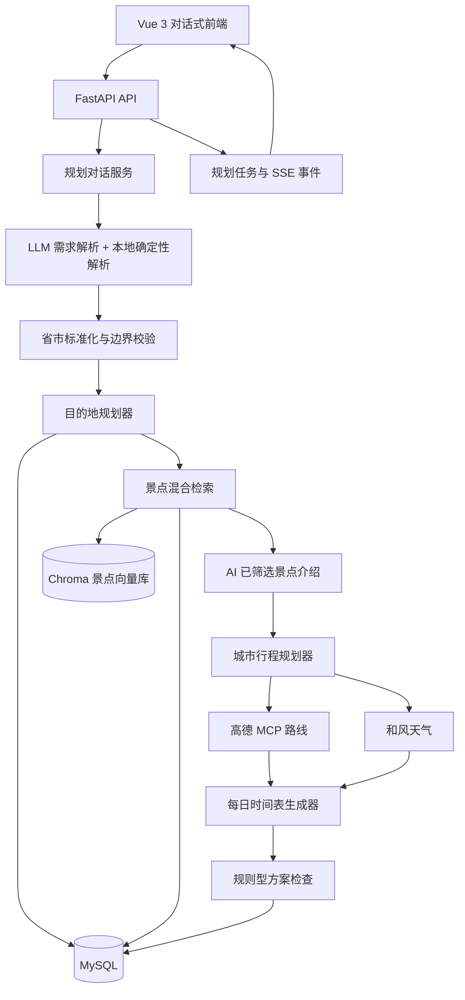

# 个性化旅游规划系统：项目详细介绍

> 文档状态：当前实现说明
>
> 更新日期：2026-09-18
>
> 项目目录：`D:\travel-agent`

## 1. 项目概述

这是一个面向短途、多城市旅行场景的个性化旅游规划系统。用户不需要填写复杂表单，而是通过自然语言与 AI 对话，逐步确定目的地、旅行天数、兴趣、游玩节奏、出发日期和每日游玩时间。所有必要需求确认后，系统才生成最终行程。

一句话概括：系统先用数据库中的省市和景点标签确定“去哪儿”，再用用户的自由偏好从景点描述中做语义和关键词匹配，最后调用地图与天气服务生成可执行的逐日行程。

系统生成的不是一段单纯的文字建议，而是一份结构化旅行方案，包含：

- 省份、城市和城市停留天数；
- 每日景点顺序；
- 两层筛选后由 AI 生成的景点展示介绍（仅用于本次方案，不写回景点表）；
- 景点数据库中的游玩时长；
- 景点之间的高德路线、距离和交通方式；
- 每日开始和结束时间；
- 用餐时间和景点之间的缓冲时间；
- 天气信息；
- 行程可执行性检查；
- 外部服务失败时的降级提示。

项目的核心设计是：

```text
自然语言对话
    ↓
结构化旅行需求
    ↓
目的地与城市天数规划
    ↓
景点标签硬筛选
    ↓
保留标签命中前 20 个候选
    ↓
偏好语义检索 + 描述关键词检索
    ↓
AI 补充已筛选景点介绍
    ↓
城市日程规划
    ↓
高德路线与天气补充
    ↓
每日时间表
    ↓
方案检查与最终展示
```

## 2. 当前产品边界

### 2.1 支持范围

- 总旅行天数：1～7 天；
- 单城市深度游：1～3 天；
- 同省多城市：1～7 天，最多 3 个城市；
- 多城市时，每个城市至少安排 1 天；
- 当前不支持跨省多城市规划；
- 出发日期必须从明天开始；
- 规划对话必须明确每日开始和结束时间，默认建议范围为 08:00～21:00；
- 用户可以在对话中指定每日开始和结束时间，但不支持跨日行程；独立排程接口在未传入时间时才使用 08:00～21:00 作为内部默认值；
- 景点之间的交通方式不由用户填写，由地图工具根据景点位置自动推荐；
- 高德返回可用周营业时间时，排程会遵守该景点当天的开放时段；没有出游日期、没有周历或数据无法可靠解析时，不限制排程并在方案中提示。

### 2.2 已明确删除或不再使用的设计

当前版本已经不再依赖以下旧流程：

- 景点事实表 `attraction_facts`；
- 景点开放时长字段；
- 景点环境字段；
- 单独的景点知识表；
- 城市表的最少天数、最多天数；
- 自动重规划、自动优化和多次自动修复流程；
- 根据用户选择的交通方式规划景点之间交通；
- 打印方案按钮和打印流程。

景点游玩时长现在直接保存在 `attractions.visit_duration_minutes`，是每日排程使用的唯一游玩时长来源。

方案检查只负责发现问题并提示用户，不会自动修改已经生成的行程。

## 3. 系统整体架构



## 4. 两种对话模式

### 4.1 普通对话模式

普通模式用于目的地知识问答、旅行灵感和一般旅游咨询，不负责收集结构化规划需求。

普通模式使用独立的数据表和接口：

- 数据表：`general_conversations`；
- 接口前缀：`/api/v1/general-conversations`；
- 知识检索：省份、城市 Markdown 知识块；
- 检索方式：BM25 + Chroma 语义检索；
- 检索结果只作为普通问答上下文，不会直接进入旅行规划需求。

### 4.2 规划对话模式

规划模式用于收集生成行程所需的全部字段。规划消息写入：

- `conversations`；
- `conversation_messages`；
- 需求草稿保存在 `conversations.requirement_draft`。

规划模式只有在所有必要字段确定后，才会向用户展示“确认生成计划”。用户确认后，系统创建规划任务并通过 SSE 推送进度。

普通模式和规划模式在后端、数据库和前端历史记录中相互隔离，普通聊天不会污染旅行规划需求。

## 5. 旅行需求模型

核心模型是 `TravelRequirement`，定义在 `backend/models/requirement.py`。

| 字段 | 含义 | 当前规则 |
| --- | --- | --- |
| `province` | 目标省份 | 需要能够在省份目录中识别 |
| `cities` | 用户指定的城市 | 需要属于同一省份，最多 3 个 |
| `province_preference_confirmed` | 是否确认省份选择方式 | 用户指定省份，或明确允许 AI 根据兴趣和偏好推荐省份 |
| `city_preference_confirmed` | 是否确认城市选择方式 | 没有指定具体城市时，需要确认由 AI 推荐还是用户指定 |
| `days` | 总旅行天数 | 1～7 天 |
| `interests` | 兴趣标签 | 先改写为省份/城市表 `tags` 中真实存在的标签，再用于目的地和景点筛选 |
| `preference_text` | 自由体验偏好 | 用于语义检索和描述关键词检索 |
| `travel_scope` | 城市安排方式 | `single_city`、`multi_city`、`auto` |
| `start_date` | 出发日期 | 必须晚于当前日期 |
| `daily_start_time` | 每日开始时间 | 规划对话中必须由用户明确提供 |
| `daily_end_time` | 每日结束时间 | 规划对话中必须由用户明确提供，且必须晚于开始时间 |
| `transport_mode` | 景点间交通模式 | 当前强制为 `auto`，由地图工具选择 |

### 5.1 天数和城市边界

| 场景 | 规则 |
| --- | --- |
| 1～3 天，未明确城市模式 | 默认按单城市深度游处理 |
| 明确单城市 | 只允许 1～3 天 |
| 4～7 天，未明确城市 | 自动进入同省多城市规划 |
| 明确多城市 | 需要 2～3 个城市，且每个城市至少 1 天 |
| 指定多个城市但总天数不足 | 直接拒绝，例如 3 个城市至少需要 3 天 |
| 指定跨省城市 | 直接拒绝，当前 MVP 不支持跨省多城市 |

城市选择不会通过城市表的隐藏最少/最多天数决定。当前多城市分配方式是：每个城市先分配 1 天，剩余天数按城市顺序均衡分配。

例如 5 天、3 个城市会得到 `2 + 2 + 1` 或同等的均衡分配，而不会退化成单城市方案。

### 5.2 对话确认顺序

实际对话不要求用户一次说完所有字段，系统会持续合并需求草稿：

1. 确认省份、城市，或明确允许 AI 推荐省份；
2. 确认旅行天数；
3. 确认单城市、多城市或由 AI 根据天数安排；
4. 如果没有指定具体城市，单独确认“用户指定城市”还是“由 AI 推荐城市”；
5. 确认兴趣和体验偏好；
6. 确认出发日期；
7. 确认每日开始和结束时间；
8. 生成完整需求摘要；
9. 用户回复确认后才开始规划。

省份推荐和城市推荐是两个独立的确认状态。用户说“你来推荐一个省份”只确认省份交给 AI 推荐，不会自动跳过后面的城市推荐确认。

### 5.3 “确认生成计划”按钮的触发条件

按钮不是根据 LLM 回复中的文字判断，而是根据后端的 `requirement_ready` 判断。只有以下条件全部满足时，后端才会返回“确认生成计划”建议：

- 省份或城市已经确定，或用户明确允许 AI 推荐省份；
- 旅行天数已确定；
- 城市安排方式已确定；
- 具体城市已指定，或用户明确允许 AI 推荐城市；
- 兴趣或自由体验偏好已确定；
- 出发日期已确定，且至少从明天开始；
- 每日开始和结束时间已确定，且不跨日。

如果 AI 文案误说“所有条件齐了”，但后端仍返回“没有指定城市，你来推荐”，以后端状态为准；系统会继续要求完成城市推荐确认，不会提前生成计划。

## 6. 自然语言需求解析

需求解析采用“两层策略”：

1. 优先使用 DeepSeek 解析结构化需求；
2. LLM 不可用或输出异常时，使用本地 `RequirementParser` 降级。

本地解析器负责：

- 省份和城市别名标准化；
- 中文数字转阿拉伯数字；
- 识别“明天”“后天”“下周一”“这个周末”等相对日期；
- 识别“每天 8 点到 21 点”等每日时间窗口；
- 识别单城市、多城市和 AI 推荐城市意图；
- 识别兴趣同义表达。

兴趣改写示例：

```text
自然风光 → 自然
山水 → 自然
拍照 / 出片 → 摄影
历史 / 文化 → 历史文化
慢游 → 休闲
```

改写后的兴趣必须与系统标签体系保持一致，之后才进入数据库标签筛选。

当前的标签改写不是只依赖写死的别名：系统会读取 `provinces.tags` 和 `cities.tags`，按“精确匹配 → 同义别名 → 唯一包含关系”的顺序，把用户或模型输出映射为数据库中的原始标签值。无法唯一映射的词不会写入 `interests`，避免出现数据库中不存在的兴趣标签。

## 7. 景点数据体系

### 7.1 MySQL 主表

景点主数据统一保存在 `attractions` 表中，当前字段包括：

| 字段 | 含义 |
| --- | --- |
| `poi_id` | 景点唯一 POI ID |
| `city_id` | 所属城市 |
| `name` | 景点名称 |
| `category` | 景点分类 |
| `tags` | 兴趣标签 JSON 数组 |
| `description` | 景点描述 |
| `longitude` / `latitude` | 经纬度 |
| `visit_duration_minutes` | 数据库中的游玩时长 |

目前规划真正依赖的景点字段是：

```text
name + category + tags + description + longitude + latitude + visit_duration_minutes
```

其中 `visit_duration_minutes` 不由高德路线工具提供，也不从开放时间推导，直接使用数据库景点表中的值。

### 7.2 景点来源

景点来源和规划职责分开：

1. MySQL `attractions` 是规划候选主目录，先按城市、标签和偏好完成筛选；
2. Chroma 只对本地景点文档做语义检索，不会把高德未筛选的景点加入候选集；
3. 高德 MCP 只对已经选出的景点按名称查询并补充详情和经纬度。

高德详情写回 MySQL 时，只更新分类、坐标等事实字段，不覆盖本地维护的标签、描述和游玩时长。高德不可用时，继续使用已经通过本地筛选的景点。

本地候选和高德详情都会做以下清洗：

- 去除重复 POI；
- 去除名称明显属于停车场、出入口等附属设施的记录；
- 规范化景点分类；
- 补充缺失坐标；
- 保持城市范围过滤。

### 7.3 当前不再使用的景点数据

以下旧字段和表已从主流程移除：

- `attraction_facts` 表；
- 开放时间；
- 环境字段；
- 参考时长；
- 外部事实来源和质量状态；
- 景点来源、描述来源、时长来源、质量标记、启停状态、坐标来源和父子景点关系字段；
- 4A/5A 核心范围开关；
- 城市适合游玩的最少/最多天数。

`attractions` 的字段白名单固定为 `id`、`poi_id`、`city_id`、`name`、`category`、`tags`、`description`、`longitude`、`latitude`、`visit_duration_minutes`。未经过用户确认和迁移设计，不得私自新增字段。

数据库迁移中会尝试把旧事实表中的游玩时长迁移到 `attractions.visit_duration_minutes`，之后删除旧事实表。

## 8. 景点筛选与排序

当前景点检索使用“标签硬筛选 + 偏好混合排序”，实现位于 [hybrid.py](../backend/rag/hybrid.py)。

### 8.1 第一步：兴趣标签硬筛选

用户兴趣经过改写后，与景点 `tags` 做精确交集匹配：

```text
tag_match_count = 景点 tags 与用户 interests 的交集数量
```

当用户明确提供兴趣时：

- `tag_match_count > 0` 的景点才进入候选集；
- 只在描述中出现兴趣词，但 `tags` 没有对应标签的景点会被排除；
- 没有任何标签匹配时返回空结果；
- 不会为了凑满景点数量而混入中性景点。

这保证了用户选择“自然”“历史文化”等兴趣时，系统不会被描述中的偶然关键词带偏。

### 8.2 第二步：旅游偏好检索

`preference_text` 与 `interests` 分开处理：

- `interests` 只负责标签筛选；
- `preference_text` 才会进入语义检索和关键词检索。

例如：

```text
兴趣：自然
旅游偏好：想轻松一点，适合散步和拍照
```

向量和关键词检索只接收“想轻松一点，适合散步和拍照”，不会把“自然”再次拼入偏好查询。

### 8.3 语义检索

景点向量库使用 Chroma，集合名默认为 `attraction_knowledge`，路径为 `data/chroma`。

当前向量文档文本仍然由以下字段组合生成：

```text
景点名称
景点分类
景点标签
景点描述
```

当前实现保留了既有向量库，不需要因为本次筛选逻辑调整而重新嵌入。向量检索时按城市 metadata 过滤，避免不同城市的景点混入结果。

这里要区分“向量文档内容”和“检索查询内容”：

- 向量文档内容：名称、分类、标签和描述的组合；
- 向量查询内容：只使用用户的 `preference_text`，不会把 `interests` 再次拼入查询；
- 语义检索结果：先按城市过滤，再与数据库标签筛选后的候选景点取交集。

因此，当前实现不是“只把描述字段嵌入向量库”，而是“用标签字段做硬筛选，再用自由偏好查询组合字段向量”。如果未来要严格实现“只嵌入描述字段”，需要修改 `AttractionDocument.index_text()` 并重建对应城市的向量索引。

### 8.4 描述关键词检索

关键词检索使用 BM25，检索文本只取景点的 `description` 字段，不使用景点标签作为关键词得分来源。

偏好词会保留现有扩展能力，例如：

```text
拍照 → 摄影、取景
轻松 → 休闲、慢游、慢节奏
散步 → 漫步、步行、步行游览
```

这样可以同时处理：

- 语义检索擅长的同义表达和整体体验理解；
- BM25 擅长的描述关键词精确命中。

### 8.5 最终排序

在标签筛选后的候选集内，使用简单、可解释的加权分数：

```text
preference_score = 0.7 × semantic_similarity
                 + 0.3 × keyword_score
```

排序优先级为：

1. `preference_score` 高的景点优先；
2. 得分相同则 `tag_match_count` 高的优先；
3. 仍相同则保持数据库候选顺序。

当前景点筛选路径不再使用 RRF，也不调用 AI reranker。BM25 模块仍保留，因为它现在作为偏好关键词检索使用，同时也可以供普通知识检索使用。

## 9. 目的地规划

目的地规划由 `DestinationPlanner` 完成，主要步骤如下：

1. 校验总天数；
2. 标准化省份和城市；
3. 从省份表和城市表读取标签词汇，并把兴趣改写为真实标签；
4. 校验城市是否属于指定省份；
5. 根据城市标签与用户兴趣计算城市匹配度；
6. 按单城市或同省多城市模式选择目的地；
7. 分配每个城市的停留天数。

### 9.1 省份和城市推荐规则

省份推荐和城市推荐使用同一套可解释的标签匹配规则，但匹配的数据层级不同：

```text
匹配分数 = 标签集合 ∩ 用户兴趣标签集合 的数量
```

- 推荐省份时，匹配 `provinces.tags`；
- 推荐城市时，匹配指定省份下的 `cities.tags`；
- 分数相同则按数据库 ID 的稳定顺序处理；
- 用户明确指定省份或城市时，不再对这一层进行推荐排序；
- 省份和城市推荐阶段不使用 Chroma 向量检索，也不使用 `preference_text` 的语义分数。

例如用户兴趣经过改写后为 `自然、古城、摄影`，某个省份标签为 `自然、摄影、美食`，则该省份的匹配分数为 2。

城市数量规则如下：

- 1～3 天：默认选择匹配分数最高的一个城市；
- 4～7 天：必须安排同省多城市，优先选择总匹配分数更高的 2～3 个城市组合；
- 用户指定城市后，尊重用户指定顺序，不再用标签分数替换城市。

省份级输入且没有具体城市时，系统先在省份层级选择匹配度最高的省份，再在该省份内选择城市。多城市规划最多选 3 个城市，并按城市匹配度和稳定 ID 排序。

当用户输入 4～7 天但仍然只指定一个城市时，系统会拒绝生成单城市方案，要求改成同省多城市；这是防止“说了 5 天却仍然只有一个城市”的边界控制。

## 10. 城市行程规划

城市规划服务会把筛选后的景点交给城市规划器。规划器使用 LLM 生成每天的景点名称和当天说明，但受到以下约束：

- 只能使用候选景点；
- 不允许编造数据库之外的景点；
- 每天必须有景点；
- Day 编号必须连续；
- 尽量避免景点重复；
- 根据景点游玩时长控制每天安排数量。

LLM 返回结果后，系统会进行结构化校验，并执行一次确定性的重复景点清理。若 LLM 规划失败，系统会使用确定性分配逻辑继续尝试；如果候选景点为空，则不会用无关景点兜底。

## 11. 景点间路线

用户不需要填写“景点之间怎么移动”。系统统一把交通模式设置为 `auto`，由高德 MCP 处理。

### 11.1 自动交通方式

在 `auto` 模式下：

- 先通过高德 MCP 距离能力判断相邻景点距离；
- 距离不超过约 1500 米时倾向步行；
- 距离较远时倾向公共交通；
- 确定模式后调用对应的高德路线工具。

支持的路线类型：

- 步行；
- 公共交通；
- 驾车。

### 11.2 路线失败时的处理

路线结果会标记来源：

| `source` | 含义 |
| --- | --- |
| `amap_mcp` | 高德 MCP 实际路线 |
| `haversine` | 无法调用路线时基于坐标的估算 |
| `unavailable` | 缺少坐标，无法计算 |
| `amap` | 历史方案兼容值 |

当前代码在高德 MCP 失败且景点存在坐标时会生成距离估算，并将 `estimated=true`；如果没有坐标，则标记为不可用。估算路线会在方案提醒中明确展示，不能视为真实交通耗时。

## 12. 每日时间表算法

每日时间表由 `ScheduleBuilder` 生成。

### 12.1 默认参数

| 参数 | 默认值 |
| --- | --- |
| 每日开始时间 | 08:00 |
| 每日结束时间 | 21:00 |
| 用餐时间 | 40 分钟 |
| 景点之间缓冲 | 20 分钟 |
| 景点缺少时长时的内部兜底 | 90 分钟 |

说明：08:00～21:00 是排程器和独立排程接口的默认窗口；规划对话要求用户明确输入每日开始和结束时间，用户输入的时间会覆盖排程器默认值。

数据库景点正常情况下都有 `visit_duration_minutes`，因此排程优先使用景点表时长；90 分钟只是在历史数据或异常数据缺失时使用。

### 12.2 计算顺序

以一天的景点列表为例：

```text
current = 每日开始时间

对每个景点：
    如果不是第一个景点：
        current += 上一个景点到当前景点的路线耗时

    如果尚未用餐且当前时间进入午餐区间：
        current += 40 分钟

    景点开始时间 = current
    景点结束时间 = 开始时间 + 数据库游玩时长
    current = 景点结束时间

    如果不是当天最后一个景点：
        current += 20 分钟缓冲
```

最后一个景点之后不再添加缓冲时间。这是为了避免出现无意义的“最后景点后还留出 20 分钟”的统计。

### 12.3 时间边界

系统会尝试安排当天景点列表的最长可行前缀：

- 能在用户指定时间窗口内完成的景点全部保留；
- 如果加入下一个景点会超过结束时间，则后面的景点不放进当天；
- 不允许景点跨到次日；
- 不会生成 `23:27—次日00:57` 这类跨日时间；
- 如果第一个景点本身就无法放入时间窗口，则直接报错，要求延长游玩时间或减少景点。

时间表状态：

- `complete`：路线数据完整；
- `estimated`：路线中存在距离估算；
- `incomplete`：部分路线没有耗时，时间表不完整。

## 13. 天气和方案检查

### 13.1 天气

每天行程完成后，系统使用和风天气 API 获取对应城市和日期的天气。

- 有日期且接口成功：显示天气；
- 没有日期：跳过天气查询；
- 接口失败：标记为不可用，不阻断整份规划。

天气成功获取后，LangChain 行程复核 Agent 会基于每天的天气现象、温度、降水概率和风力，生成一条简短的天气出行建议（例如晴天防晒、降雨带伞防滑）。该建议只帮助用户理解天气与出游体验，不改变景点、顺序或时间窗口；没有可用预报或 Agent 未启用时不生成 AI 建议。

### 13.2 规则型评估器

评估器只检查景点间路线负担与路线数据可靠性；每日时间窗口由排程器执行，不再将总耗时密度和兴趣覆盖作为评估项。

- 景点间单段路线是否超过约 60 分钟；
- 每日路线总耗时是否超过约 180 分钟；
- 路线是否为估算、不可用或存在其他降级状态。

评估器只输出问题与建议，不调整景点排序或权重；排程使用偏好/距离 `0.4/0.6`，每日时间窗口保持不变。AI 可根据实际天气预报为当天行程生成出行提示，但不参与景点增删、重排或时间窗口计算。

评估结果以结构化问题返回：

```json
{
  "type": "route",
  "severity": "medium",
  "day": 2,
  "message": "景点 A 到景点 B 预计需要 65 分钟",
  "suggestion": "优先替换为距离更近的景点或调整顺序"
}
```

用户需要返回对话调整需求，系统不会因为检查发现问题而自动重规划，也不会自动连续优化两次。

## 14. 规划任务、进度和断线恢复

用户确认生成方案后，后端创建 `planning_jobs` 任务，并把进度写入 `planning_events`。

典型进度步骤：

```text
requirement
destination
poi_search
retrieval
city_plan
route_enrichment
weather_enrichment
schedule
evaluation
complete
```

前端通过 SSE 接收：

- `planning_progress`：阶段进度；
- `destination_choice_required`：需要用户选择单城市/多城市时的选项；
- `plan_completed`：最终旅行方案；
- `planning_error`：规划失败；
- 心跳事件：保持连接。

每个事件都有递增序号。前端断线后，会携带 `after` 游标和 `job_id`，从上一次收到的事件继续回放，而不是重新创建一份方案。

规划任务支持：

- 重复提交时复用当前任务；
- 任务状态持久化；
- worker 心跳；
- worker 失效后租约接管；
- 可选 Redis 外部队列；
- 队列不可用时回退进程内 worker。

这类“重试”是任务执行层面的断线恢复，不是旧版本的自动重规划或自动优化。

## 15. 数据库结构

### 15.1 目录和景点

```text
provinces
    └── cities
            └── attractions
```

- `provinces`：省份名称、行政区代码、标签和描述；
- `cities`：所属省份、城市名称、行政区代码、标签和描述；
- `attractions`：城市景点主数据、标签、描述、坐标和游玩时长。

### 15.2 对话和方案

- `conversations`：规划会话和需求草稿；
- `conversation_messages`：规划模式消息；
- `general_conversations`：普通对话和普通模式消息；
- `travel_plans`：生成后的方案版本；
- `planning_jobs`：规划任务状态；
- `planning_events`：规划进度事件。

### 15.3 向量和缓存

- `data/chroma/attraction_knowledge`：景点向量集合；
- `data/chroma/travel_guides`：普通对话旅行主题文档向量集合；
- Redis：可选缓存层，不是景点主数据来源。

建议缓存时间：

| 数据 | 默认 TTL |
| --- | --- |
| POI 搜索 | 24 小时 |
| 路线 | 3 小时 |
| 天气 | 1 小时 |
| 旅行主题文档向量 | 持久化在 Chroma |

## 16. 主要后端目录

```text
backend/
├── api/                 FastAPI 路由
├── application/         规划任务、worker、SSE 编排
├── config/              环境变量和系统配置
├── conversation/        普通对话与规划对话服务
├── database/            SQLAlchemy 表、迁移和初始化
├── destination/         省市解析、校验和城市天数分配
├── evaluator/           方案检查
├── knowledge/           景点描述维护、景点资料准备
├── models/              Pydantic 领域模型
├── planner/             城市规划和完整旅行工作流
├── poi/                 高德 MCP 景点搜索和本地数据库 provider
├── rag/                 BM25、Embedding、Chroma 和混合检索
├── requirements/        需求解析、日期和兴趣改写
├── route/               高德 MCP 路线和路线补充
├── schedule/            每日时间表
├── travel_plans/        旅行方案持久化
└── weather/             和风天气
```

前端主要目录：

```text
frontend/src/
├── App.vue                         应用入口与页面状态切换
├── components/ChatPanel.vue        对话区和建议按钮
├── components/PlanningView.vue     规划进度和城市选择
├── components/TravelPlanView.vue   最终逐日行程展示
├── components/ConversationSidebar.vue 会话历史
├── stores/planning.ts              对话、任务、SSE 和方案状态
├── api.ts                          API 请求封装
└── types.ts                        前端类型定义
```

## 17. 主要 API

### 17.1 系统和普通对话

```text
GET  /health

POST   /api/v1/general-conversations
GET    /api/v1/general-conversations
GET    /api/v1/general-conversations/{conversation_id}
DELETE /api/v1/general-conversations/{conversation_id}
POST   /api/v1/general-conversations/{conversation_id}/messages
```

### 17.2 规划对话和方案

```text
POST   /api/v1/conversations
GET    /api/v1/conversations
GET    /api/v1/conversations/{conversation_id}
DELETE /api/v1/conversations/{conversation_id}
GET    /api/v1/conversations/{conversation_id}/plans
POST   /api/v1/conversations/{conversation_id}/messages
PATCH  /api/v1/conversations/{conversation_id}/requirement
POST   /api/v1/conversations/{conversation_id}/requirement/confirm
POST   /api/v1/conversations/{conversation_id}/plan
GET    /api/v1/conversations/{conversation_id}/plan/events
```

### 17.3 独立规划和检索接口

```text
POST /api/v1/travel/plan
POST /api/v1/planning/city
POST /api/v1/requirements/resolve

GET  /api/v1/cities/{city}/attractions
GET  /api/v1/retrieval/vector
POST /api/v1/retrieval/index
POST /api/v1/retrieval/hybrid
```

### 17.4 景点知识接口

```text
GET  /api/v1/attractions/{poi_id}/knowledge/status
POST /api/v1/attractions/{poi_id}/knowledge
```

## 18. 外部服务

| 服务 | 用途 | 失败时的处理 |
| --- | --- | --- |
| DeepSeek 或兼容 LLM | 需求解析、对话回复、已筛选景点介绍、城市日程生成 | 需求解析和景点介绍保留本地资料；城市规划使用确定性兜底 |
| 高德 MCP | 景点之间的距离、步行/公交/驾车路线 | 路线生成估算或不可用标记 |
| DashScope Embedding | 景点和普通知识向量嵌入 | 景点偏好检索保留标签/关键词排序 |
| 和风天气 | 每日天气 | 标记天气不可用，不阻断规划 |
| MySQL | 目录、对话、任务和方案持久化 | 核心依赖，连接失败会阻断业务 |
| Redis | 缓存和可选规划队列 | 不可用时旁路缓存；队列可回退本地 worker |

## 19. 配置项

项目主要从根目录 `.env` 读取配置。常用配置如下：

```text
DATABASE_URL=mysql+pymysql://...

LLM_API_KEY=...
LLM_BASE_URL=https://api.deepseek.com
LLM_MODEL=deepseek-v4-flash

AMAP_API_KEY=...
AMAP_MCP_URL=https://mcp.amap.com/mcp

QWEATHER_API_KEY=...
QWEATHER_API_HOST=...

DASHSCOPE_API_KEY=...
EMBEDDING_MODEL=text-embedding-v3
EMBEDDING_DIMENSIONS=1024

REDIS_URL=redis://...
REDIS_WSL_DISTRO=Ubuntu
```

每日排程相关配置：

```text
SCHEDULE_DAY_START_TIME=08:00
SCHEDULE_MEAL_MINUTES=40
SCHEDULE_BUFFER_MINUTES=20
```

方案评估相关配置：

```text
EVALUATOR_MAX_DAY_MINUTES=600
EVALUATOR_MAX_ROUTE_SEGMENT_MINUTES=60
EVALUATOR_MAX_DAILY_ROUTE_MINUTES=180
EVALUATOR_MINIMUM_INTEREST_COVERAGE=0.5
```

虽然项目仍保留 reranker 配置字段以兼容旧配置，但当前景点混合检索路径不会调用 AI reranker。

## 20. 本地启动

### 20.1 后端

```powershell
cd D:\travel-agent
python -m pip install -e ".[dev]"
python -m uvicorn backend.main:app --host 127.0.0.1 --port 8000 --reload
```

健康检查：

```powershell
Invoke-RestMethod http://127.0.0.1:8000/health
```

### 20.2 前端

```powershell
cd D:\travel-agent\frontend
npm install
npm run dev
```

访问：`http://127.0.0.1:5173`

### 20.3 向量知识库

普通对话的旅行主题文档更新后，可以执行：

```powershell
cd D:\travel-agent
python scripts/rebuild_travel_guides_index.py
```

省份、城市、景点基础信息不进入该知识库，由大模型直接回答；路线和天气分别调用对应的实时工具。

景点向量库会在景点检索时通过内容哈希检查是否需要更新；景点表的名称、分类、标签或描述发生变化后，会自动重新嵌入对应城市数据。

## 21. 测试和构建

后端测试：

```powershell
cd D:\travel-agent
pytest -q
```

前端测试：

```powershell
cd D:\travel-agent\frontend
npm test -- --run
```

前端生产构建：

```powershell
npm run build
```

当前混合检索相关测试覆盖：

- 标签硬筛选；
- 描述关键词检索；
- 偏好向量查询不混入兴趣标签；
- 语义分数和关键词分数加权；
- 向量服务失败后的关键词降级；
- 没有标签匹配时返回空；
- 数据库景点游玩时长透传；
- “自然风光”改写为“自然”。

## 22. 当前已知限制

1. 当前多城市只支持同省，暂不支持跨省路线和城市间交通规划。
2. 当前向量索引仍包含名称、分类、标签和描述；如果要严格实现“只嵌入描述”，需要重新生成向量。
3. 高德 MCP 路线失败时，系统可能使用基于坐标的距离估算；估算值只用于保持时间表可生成，不能当作真实交通时间。
4. 景点营业时间依赖高德 POI 覆盖；未返回周营业时间的景点不会受开放时段约束，门票、排队时间、预算和住宿价格还没有纳入约束。
5. 方案检查只提示问题，不会自动修正行程。
6. 规划模式暂时是匿名会话，没有用户登录和跨设备同步。
7. 景点介绍由 LLM 基于本地候选资料生成，仅用于本次方案展示，不作为数据库事实核验结果。
8. LLM 生成的每日景点数量仍受候选数量和游玩时长影响；当一个城市可用候选景点很少时，可能出现某天只有一个景点。
9. 当标签没有匹配景点时，检索层会返回空结果；产品层应继续引导用户选择系统支持的兴趣标签，而不是自动推荐无关景点。

## 23. 后续建议

如果继续迭代，建议按下面顺序推进：

### 第一阶段：提高数据质量

- 检查各城市景点 `tags` 是否覆盖核心兴趣；
- 清理重复、附属设施和名称异常的 POI；
- 为关键景点补充更准确的 `description` 和 `visit_duration_minutes`；
- 对高德新 POI 和本地演示 POI 增加来源标记，便于后续审计。

### 第二阶段：提高规划稳定性

- 在没有标签匹配时，把空结果转换成明确的对话提示；
- 在候选景点不足时，提前告诉用户“当前城市可用景点数量有限”；
- 将路线估算和真实路线在前端用不同视觉状态展示；
- 让方案检查直接返回“需要用户修改的字段”，而不是只返回自然语言建议。

### 第三阶段：提高检索质量

- 当前方案使用偏好/距离 `0.4 / 0.6`，后续观察真实路线连贯性；
- 根据日志统计语义命中和关键词命中的差异；
- 如果描述质量足够，再单独构建“只嵌入描述字段”的新向量集合做 A/B 对比；
- 暂时不恢复 AI reranker，除非简单加权排序在真实案例中明显不足。

### 第四阶段：完善产品能力

- 用户登录和多设备会话；
- 住宿和城市间交通；
- 门票、开放时间和预约提醒；
- 手动拖拽调整景点顺序；
- 用户修改后重新生成整份方案，但保持显式触发，不做后台自动重规划；
- 方案导出 PDF 或分享链接。
